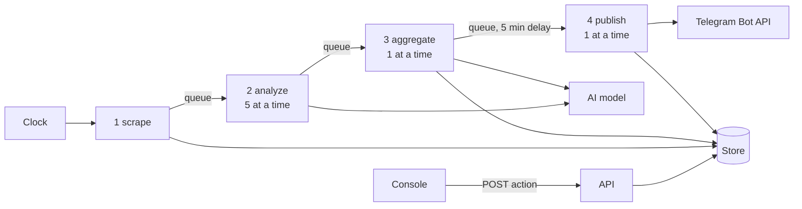

# Telegator — functional specification

Telegator reads news posts from Telegram chats and asks an AI model to classify each one. It groups the posts that report one story into one **message** and posts that message to Telegram channels (**targets**). When more sources report the story, it **edits the post in place** instead of posting again. Operators watch and steer the pipeline from a web console.

This spec defines *behaviour*: inputs, outputs, rules, numbers and failure handling. A rebuild that follows it gives the same posts, the same records and the same console actions. For how the current build maps onto Firebase, see [../telegator.md](../telegator.md).

## 1. Conventions

- **MUST**, **MUST NOT** and **MAY** are normative. Everything else explains.
- Each rule has an id (`IN-3`, `PB-12`) so tests and reviews can cite it.
- Times are epoch milliseconds (UTC) unless the text says ISO.
- "Store" means the durable document store. The reference build uses Firestore, but any store that offers the operations in [01-data.md](01-data.md) §10 works.
- Every constant is defined in one place only: the file that uses it.

## 2. Actors and external systems

| Actor / system | Role |
| --- | --- |
| **Telegram user account** (MTProto) | Reads posts from channels, groups and chats. |
| **AI model** (Claude Haiku 4.5 via OpenRouter) | Classifies posts, judges unclear duplicates, explains failures. |
| **Telegram bot** (Bot API) | The only outbound sink: sends and edits posts on targets. |
| **Operator** | A signed-in console user with role `viewer`, `editor` or `admin`. |
| **Clock** | Starts scheduled work: scrape every 30 min, queue sweep every minute, YouTube every 6 h. |
| **YouTube** (Data API + caption fetcher) | Feeds the separate YouTube absorber ([08-youtube.md](08-youtube.md)). |

## 3. The system in one picture

A post moves through four stages. Between stages it waits as an item in a **work queue** that the store holds. Only the message is a durable record of a post: aggregate stores the post's content *inside* the message.

## 4. Glossary

| Term | Meaning |
| --- | --- |
| **Source** | A Telegram chat that the system polls. |
| **Post** | One Telegram message, as the reader returns it. |
| **Item** | A post in flight between stages. Its id is `{sourceId}/{postId}`. |
| **Message** | One story: up to 20 items (its **members**) that report the same event. |
| **Target** | A Telegram channel that receives the messages whose tags it wants. |
| **Post record** | Which Telegram post on which target shows a message (`posts`). |
| **Stage** | One step of the pipeline: `analyze`, `aggregate` or `publish`, each with its own queue. Scrape is the scheduled step in front of them. |
| **Date key** | `YYYY-MM-DD` in UTC, the day the post was **scraped**. It partitions dedup. |
| **Link token** | `[text](#N)` in a post body. It stands for the N-th link of that post. |
| **Audit entry** | An append-only record of a rejected send or a failed item. |

## 5. Contents

| File | Covers |
| --- | --- |
| [01-data.md](01-data.md) | Records, ids, field rules, invariants, store operations. |
| [02-intake.md](02-intake.md) | Stage 1: choosing sources, reading Telegram, building items. |
| [03-queue.md](03-queue.md) | The work queue: retries, leases, sweep, operator controls. |
| [04-classify.md](04-classify.md) | Stage 2: pre-filter, the AI contract, routing. |
| [05-dedup.md](05-dedup.md) | Stage 3: match key, score, merge or create, adjudication. |
| [06-publish.md](06-publish.md) | Stage 4: routing to targets, message layout, send or edit. |
| [07-console.md](07-console.md) | Operators, roles, the API, console pages, agent tools. |
| [08-youtube.md](08-youtube.md) | The separate YouTube-to-knowledge absorber. |
| [09-acceptance.md](09-acceptance.md) | End-to-end scenarios that prove a rebuild, and the quirks to keep. |

## 6. Global rules

- **G-1** The pipeline MUST NOT post to a target twice for one message. A later change MUST edit the existing post.
- **G-2** Every stage MUST be safe to run again on the same input (a **replay**). A replay MUST NOT create a record, a post or a change that a reader can see.
- **G-3** A false merge (two stories shown as one) is worse than a duplicate post. When in doubt, the system MUST keep stories apart.
- **G-4** Scheduled scraping MUST stay off until an operator turns it on (`SCRAPE_ENABLED=true`). A first deploy MUST NOT start posting.
- **G-5** Deletes of sources, targets and messages are **soft**: they set `deleted: true`. Lists and the pipeline MUST ignore deleted rows.
- **G-6** Secrets (bot token, AI key, MTProto session, OAuth tokens) MUST NOT appear in logs, errors or API answers.
- **G-7** Local and test runs MUST NOT post to live channels. They use a placeholder bot token unless a test bot's token is set.
- **G-8** Every stage writes counters to [metrics](01-data.md#8-metrics) at the end of each run, whether the run succeeded or failed.

## 7. Out of scope

- Reading Telegram photos for publishing: an MTProto photo has no public URL, so a photo post publishes as text.
- Alerts. The console shows failures; nothing pages anyone.
- Any target kind other than a Telegram channel.
