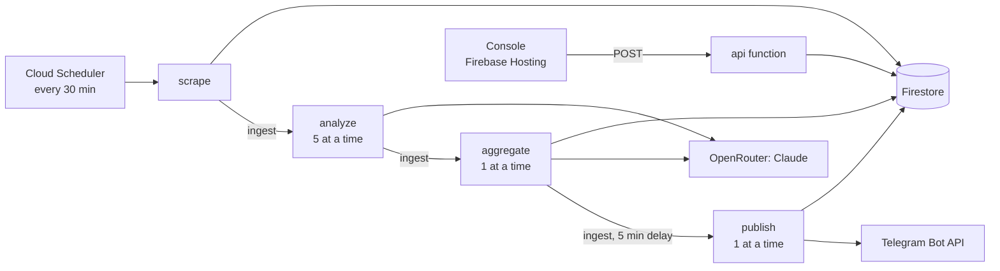

Telegator collects posts from Telegram channels and groups and asks an AI model to classify each one. It groups the posts that report the same story into one message and publishes that message to target channels. When more sources report the story, the message is **edited in place**. Operators use a web console to watch the pipeline and step in.

The behaviour, stated precisely enough to rebuild the system, is in the [functional spec](spec/README.md).

## 1. The system in one picture



**The queue is the pipeline.** A post in flight is an `ingest` document: its payload in `raw`, its `status` (`pending`, `running`, `done`, `error`), `retryCount`, `runAt` and timestamps. `aggregate` absorbs it into a message, where it is stored *inside* that message. A `done` item is deleted by a TTL policy after 7 days; an `error` one keeps its message (`error`) and what lay behind it (`cause`) until an operator runs, replays or discards it.

| Concern | Firebase piece | Code |
| --- | --- | --- |
| Clock | `onSchedule`, every 30 min | `tg-functions/index.ts` |
| Work in flight | Firestore `ingest`, drained by the `ingest` trigger and `sweep` | `tg-firebase/tasks.ts`, `ingest.ts` |
| Durable records | Firestore: `sources`, `targets`, `messages`, `videos` | `tg-firebase/db.ts` |
| Failed work | `ingest` items with `status = error` | `tg-firebase/errors.ts` |
| Counters | Firestore `metrics`, one doc per hour | `tg-firebase/metrics.ts` |
| Operators | Firebase Auth + Firestore `users` | `tg-firebase/operators.ts` |
| Console API | one `onRequest` function, `api` | `tg-api/` |
| Console | Arrmatura app on Firebase Hosting | `tg-web/` |
| YouTube absorber (§10) | `onSchedule`, every 6 h | `tg-youtube/` |
| Secrets | `defineSecret` (Secret Manager) | `tg-functions/index.ts` |

## 2. Data

All ids that contain `/` (`channel/12345`) are stored with `~` in the document id. The real id is always in the `id` field. A delete is **soft**: it sets `deleted: true`, and lists hide that row.

### 2.1 `sources` — channels to poll

| Field | Meaning |
| --- | --- |
| `id` | Channel username; also the scrape URL segment. |
| `status` | `ok` enables polling. Any other value disables it. |
| `category`, `tags`, `teaser` | Operator settings stamped onto every post. `tags` is an array; publish routes by it (§3.4). `teaser` is boilerplate stripped from the body. |
| `type` | The reader: `telegram` (a logged-in account over MTProto, default). Was `via` (`web`, `mtproto`), then `telegram_channel` / `telegram_mtproto`; `npm run migrate:source-type` folds stored docs into `telegram`. |
| `lastItemId` | Newest post id seen. The `?after=` cursor and **the only duplicate guard** on the way in. |
| `lastCount`, `lastUpdated`, `lastResult` | Last poll: post count, epoch ms, ISO time of success. |
| `zeroYieldRuns`, `lastNonZeroCount` | Empty polls in a row, and the last non-empty count. Together they detect a stale source. |

### 2.2 The post in flight

`scrape` → `analyze`: `id` (`{source}/{tgId}`), `body` (links replaced by `[text](#N)` tokens), `links`, `image`, `forwardedFrom`, `category`, `tags`, `date` (**the scrape day**, which is the dedup partition) and `kind`. `analyze` → `aggregate` adds the AI fields of §4.

### 2.3 `messages` — stories

| Field | Meaning |
| --- | --- |
| `id` | The first item's id. |
| `status` | `topublish` → `published`. A merge sets it back to `topublish`. |
| `members` | Map `itemId → {summary, links, channel, ts}`: all that publish renders. At most **20**. |
| `memberCount`, `memberIds` | Size of the map, and its keys (for the replay check). |
| `keyEntities`, `keyTitle`, `keyTags` | The dedup match key (§5). |
| `date`, `title`, `category`, `country`, `location`, `peoples`, `tags`, `image` | Copied or merged from members. |
| `tgChannel` | Legacy comma-separated targets. No longer written; publish reads it only to find a legacy `tgId`. |
| `posts` | Map `target → {tgId, tgAt}`. A post present makes the next publish an **edit**. |
| `ts`, `deleted` | Last write; soft delete. `deleted` is always written, so queries can filter on it. |

The map makes replay free: writing `members.{itemId}` again writes the same value.

### 2.4 `targets`

`id` (channel), `type`, `tags`, optional `messageTemplate`, and `lastPostedDate` / `lastPostedMessageId`, which publish writes. A target receives every message whose `tags` include all of its own, case-insensitively; a target with no tags receives nothing.

### 2.5 `audit` — what went wrong

Append-only, two kinds of entry, each with `error` and `at`:

- `send`: publish writes one per send Telegram rejected, with `messageId`, `target`, `method`, and Telegram's reason as `error`. Entries older than `kind` are all sends.
- `item`: an item's last failed attempt (§3) writes one, with `stage`, `itemId`, `ref` (the post or message it carries) and `cause`.

Both outlive the `ingest` error, which goes on replay or discard. A TTL policy on `expireAt` deletes an entry after 30 days.

## 3. Stages

Each task stage drains its own `ingest` items. A drain holds the stage's lease (`ingestLeases/{stage}`), so one drain runs per stage, and it runs at most *concurrency* items at once, oldest `runAt` first. A thrown error sets the item back to `pending` with a backoff of 30 s, doubling per attempt; the last attempt sets it `error` and writes an `item` entry to `audit` (§2.5). Every failure records the message in `error` and its `cause` chain, or else its stack, in `cause`.

- **Trigger.** `ingest` (`onDocumentWritten`) drains a stage as soon as one of its items is `pending` and due: on enqueue and on replay.
- **Sweep.** `sweep` runs every minute. It runs what came due later (the publish delay, a retry's backoff) and fails the items of a drain that died: `running` past their lease counts as one attempt.
- **Ids.** `enqueue` with an `id` is a create-if-absent write, so a second request with that id is refused.
- **Scrape node** (Dashboard page). Lists the enabled `telegram` sources and when each is due. The sources the next run polls come first. A click on one opens a modal with all its fields, where an editor may change or delete it (soft). *Scrape now* is off when none is due. A second tab (`?tab=all`) lists every source, any reader and status, by id, type, status and last count; a click opens the same modal. An editor adds an enabled `telegram` source by id, and ticks and deletes in bulk; anyone exports CSV, an admin resets every cursor (two presses). *Emulate a post* queues one canned fake post from the source `emulated` for analyze. It is published like any post: to the targets its AI tags match.
- **Publish node** (Dashboard page). Besides its queue and *Publish now*, lists the targets in a table. An editor adds one by id; a click on its id opens a modal with all its fields, where its type, tags and message template may change, or it may be deleted (soft). An editor may also tick several and delete them at once; anyone may export them as CSV. There is no Targets page.
- **Item modal** (Dashboard and Audit pages). A row of a stage's queue or a failed item opens its item whole: status, error, cause and payload. An admin may edit the payload's text fields of a waiting or failed item; the edit must pass the stage's schema.
- **Failed items** (Audit page). Lists every stage's `error` items, oldest first, with message and cause. *Run* starts one afresh at the head of its stage; *Analyse* asks the model (§4); *Replay* and *Discard all* act on all of them.
- **Operator control** (`ingestControls/{stage}`, Dashboard page, admin). *Run now* makes a stage's waiting items due at once, skipping delay and backoff. *Pause* holds the stage: trigger and sweep run nothing of it but its budget. *Step N* makes the oldest N waiting items due and adds N to the budget. *Run now*, *Step* and *Publish now* are off when nothing waits. Each control write wakes the stage through the `ingestControl` trigger. *Reset ingest* (two presses) deletes every `ingest` item, whatever its status; pause settings stay.

| Function | Trigger | Attempts | Concurrency |
| --- | --- | --- | --- |
| `scrape` | every 30 min, if `SCRAPE_ENABLED` | — | — |
| `ingest`, `sweep` → analyze | `ingest`, stage `analyze` | 3 | 5 |
| `ingest`, `sweep` → aggregate | `ingest`, stage `aggregate` | 3 | **1** |
| `ingest`, `sweep` → publish | `ingest`, stage `publish` | 5 | **1** |
| `api` | HTTPS | — | — |
| `youtube` | every 6 h, if `YOUTUBE_PLAYLIST_ID` is set (§10) | — | — |

### 3.1 scrape

- **Selection.** Sources with `status = ok` and this reader's `type`. A **hot** source (more than 20 posts last run) is always due. A **warm** one (1–20) is due after 30 min, a **cold** one (0) after 240 min. Most overdue first, at most **10** per run.
- **Telegram** (`tg-mtproto/`). Reads through the logged-in account in `MTPROTO_SESSION` (GramJS), so channels, groups and chats alike. One run reads at most 20 messages after `lastItemId`, oldest first; an empty cursor reads the newest 20. A photo post publishes as text: an MTProto photo has no public URL.
- **Kinds.** `forward`, `empty`, and `obsolete` (posted more than 3 days ago, or with no date) are dropped with a counter. Only `post` is enqueued.
- **Cursor.** Written only when every enqueue succeeded, so a failure retries the window next run.
- **Stale source.** 3 empty runs on a source that once yielded counts `SourceStale`.

### 3.2 analyze

An empty body or a bare link is dropped before the model call. Otherwise one classification (§4). Routing: no category → throw (retry); `importance = low` → drop; otherwise enqueue to `aggregate`. `country` is uppercased, and AI tags are merged with source tags (array, AI first, each once).

### 3.3 aggregate

Dedup (§5) decides **merge** or **create**. A merge writes `members.{itemId}` and the scalars attribute by attribute, keeps `posts`, and sets `topublish`. A create uses a create-if-absent write. Then it asks for a publish. Requests for one message within one 5-minute window share an item id, so a burst of merges publishes once, after the story settles.

The stage runs **one item at a time**. Two items of the same day therefore can never both miss each other's write. SQS FIFO serialised per day; this serialises everything, which is ample at this volume.

### 3.4 publish

1. Skip the message if it is gone, deleted, or no longer `topublish`.
2. For each live target that receives the message (§2.4) and has no current post: assemble the text and send it, or edit it when `posts[target]` exists. A message no target receives is marked `published` with no post.
   - Assembly: a header, up to 12 member blocks, then hashtags. The limit is 4096 characters: hashtags are dropped first, then member blocks.
   - A photo is used only for a first send and only when the text fits in 1012 characters.
3. Record `posts` after **every** send, so a retry never posts twice.
4. Write `published` only when every target succeeded. A rejected send is recorded in `audit` (§2.5) and throws, naming each target, method and Telegram's reason; the console shows it on the `error` item.

The bot pauses at least 3 s after each send and retries once on `429`. Telegram answers errors with HTTP 200 and `ok: false`.

## 4. AI

All three calls go to Claude through OpenRouter's Anthropic-compatible Messages API (`https://openrouter.ai/api`, no `/v1`; the SDK adds it). The model is `anthropic/claude-haiku-4.5`, defined once in `tg-configs/ai.ts`.

- **Classify** (`tg-ai/openrouter.ts`): JSON-schema output with `title`, `summary` (Belarusian, at most 220 characters, stated in the field description), `country`, `location`, `category` (enum in `tg-enums/categories.ts`), `importance`, `peoples`, `properNames`, `tags`. The system prompt keeps `[text](#N)` tokens intact.
- **Adjudicate** (`tg-ai/adjudicator.ts`): ambiguous dedup pairs, using English fields only. Verdicts are keyed by pair id, and a set that does not cover every pair is an error.
- **Diagnose** (`tg-ai/diagnoser.ts`): on an admin's *Analyse* of an `error` item, the `api` function sends its stage, message, cause, attempts and the first 4000 characters of its payload. The answer, `{summary, cause, fix}`, is stored on the item as `diagnosis`, so a second look costs nothing. The `api` function therefore holds `OPENROUTER_API_KEY` too, and `MTPROTO_SESSION` for *Scrape now*.
- `npm run smoke:openrouter` is the only check that calls the real model.

## 5. Deduplication

Code: `tg-dedup/`. Constants: `tg-configs/dedup.ts`.

- **Match key**: three sorted, lowercased sets: entities (`peoples` + `properNames`), title words, and tags. A merge takes the sorted union, capped at 256 per set.
- **Score** = weighted Jaccard of the three sets. `J(∅, ∅) = 0`: no evidence is not agreement.
- **Gate**: same `date` only. Category and country are not gated.
- **Band**: score at or above `MERGE_THRESHOLD` → merge. At or below `DISTINCT_THRESHOLD` → separate. In between → adjudicate. A failed adjudication **splits**, because a false merge is worse than a duplicate post.
- **Replay**: an item already in a candidate's `memberIds` merges there before any scoring. A replay is therefore exactly idempotent.
- ⚠️ **Thresholds are provisional.** Run the calibration sweep (`tg-dedup/calibration/`) and record `calibration/record.json` before trusting dedup quality.
- ⚠️ **Known limit**: the sweep scores item against item, but runtime scores item against a message's union key. A message with many members makes true matches score lower.

## 6. Console

`packages/tg-web`: Arrmatura app with these pages: Dashboard (the pipeline diagram; the selected stage is `?node=`, so a link opens it; with none, the overview; sources live on its Scrape node, targets on its Publish node), Messages, Audit.

- **Audit**: a Messages row carries a red count of its open `audit` entries, those no later successful post on that target has resolved; its expanded panel lists them under the members. The Audit page lists every stage's failed items (§3), then its History: the newest 200 entries of both kinds.

- **Sign-in**: the platform's `FirebaseService`, with Google in production and the Auth emulator locally. The browser holds no Firestore access; `firestore.rules` denies everything.
- **API**: `POST {data: {action, input}}` to `api`. The answer is `{data: {ok, result}}`, or an error with 400 / 401 / 403 / 500.
- **Roles**: `viewer` < `editor` < `admin`, kept in `users/{uid}.roles`. A first sign-in creates the user **disabled with no roles**, and an admin enables it in Firestore. `users` is read on every call, so disabling takes effect at once.
- **Actions** (`tg-api/actions.ts` maps each to its least role):

| Role | Actions |
| --- | --- |
| viewer | whoami, overview, list sources/targets/messages, members, audit, inspect queues and errors, export CSV |
| editor | upsert and soft-delete records |
| admin | scrape now, emulate a post, reset ingest, reset cursors, republish, publish now, run, pause or step a stage, run one item, analyse, replay or discard errors |

- **Dashboard numbers** come from the hourly `metrics` docs (24 h counters, 7-day categories) items in queue per stage (`pending` or `running`), and the `error` items of all stages.

## 7. Development

```bash
npm install              # also links the private arrmatura checkouts
npm run dev              # emulators + functions watch + console on :8080
```

`npm run dev` builds the functions bundle, then runs these in parallel:

- the **emulators**: Auth 9099, Functions 5001, Firestore 8180, Tasks 9499, UI 4000. Data persists in `.emulator/`.
- an esbuild **watch** of `tg-functions`. The Functions emulator reloads on every rebuild.
- the **console** with live reload at `http://localhost:8080`.
- the **vibe server** on 127.0.0.1:8091: Cmd+I in the console opens the DevTools drawer, whose agent edits this repo.
- once the emulators are ready, `seed:upload:dev -- --write` restores the dev snapshot (if any), then the console opens.

| Need | Do |
| --- | --- |
| Secrets for the emulator | `packages/tg-functions/.secret.local` (git-ignored), linked from `~/.keys/.env` (shared by all projects). `TELEGRAM_BOT_TOKEN` there is a placeholder, so local runs never post to live channels. Put a test bot's token there to try publishing. |
| Sign in locally | Press *Sign in*. The Auth emulator signs in `dev@example.com`, and the first emulator sign-in is an enabled admin. |
| Data | `npm run seed:download:dev` or `seed:download:prod` saves `sources`, `targets` and `users` to `packages/tg-seed/data/<env>/<collection>.json` (git-ignored). `npm run seed:upload:dev -- --write` makes each dev collection match its file, deleting documents missing from it; dry run without `--write`. |
| A scrape | *Scrape now* on the Dashboard page's Scrape node. Scheduled functions do not fire in the emulator, so neither does `sweep`: drive the flow from the Dashboard page instead. *Run now* runs a stage's delayed and retried items, *Pause* and *Step* walk items through one at a time, *Run* on a failed item of the Audit page re-runs it. |

Scripts (`mcp`, `cursors:now`, `autofix`) use the emulator when `FIRESTORE_EMULATOR_HOST` is set; `seed:*` picks it by its `dev|prod` argument. Otherwise they use production through `gcloud auth application-default login`.

`npm run autofix` reads the `ingest` errors, groups them by stage and message, and asks Claude Code (`claude -p`, in this repo) for each group's root cause: `data` (corrected payloads), `code` (a code fix) or `none`. Dry run unless `--apply`; then Claude may edit code (edit tools and the four gates only), corrected payloads are saved through `editItem` and run again, and Claude's reading is kept as each item's diagnosis. A code fix needs a deploy, then *Replay*.

**Gates**: all four pass before a commit.

```bash
npx tsc --noEmit
npm test                 # vitest inside `firebase emulators:exec` (Firestore + Auth)
npx biome check .
npm run build            # console bundle + functions bundle
```

Tests never touch the network. Pure logic is unit-tested, and Firestore code runs against the emulator. The model is mocked, and stage tests mock `tg-firebase/tasks` with `vi.mock`. `npm test` cannot start while `npm run dev` holds the ports; in that case run `FIRESTORE_EMULATOR_HOST=127.0.0.1:8180 GCLOUD_PROJECT=demo-test npx vitest run`.

## 8. Deployment

One Firebase project, `telegator-581db`. Functions run in `us-central1`, next to Firestore (`nam5`).

1. The project must be on the **Blaze** plan: Functions and Scheduler need it.
2. Set the secrets once: `firebase functions:secrets:set OPENROUTER_API_KEY`, the same for `TELEGRAM_BOT_TOKEN`, `npm run mtproto:login` for `MTPROTO_SESSION`, and `npm run youtube:login` for `YOUTUBE_OAUTH` (§10).
3. Enable the Google provider in Firebase Auth. Add its OAuth web client id to `firebaseConfig.googleClientId` in `tg-configs/firebase.ts`, and list the site's origins on that client.
4. `npm run deploy`: builds both bundles, then deploys hosting, functions, Firestore rules, indexes and the `ingest.expireAt` and `audit.expireAt` TTL policies.
5. Sign in once, then set your `users/{uid}` to `{enabled: true, roles: ["admin"]}` in the Firestore console.
6. Start the schedule: set `SCRAPE_ENABLED=true` in `packages/tg-functions/.env` and redeploy the functions.

## 9. Decisions and limits

- **Serial aggregate and publish.** Both stages run one item at a time under their lease. Fine at hundreds of posts a day; revisit with per-day locking if volume grows a hundredfold.
- **Publish dedup** is an item id per message per 5-minute window. A request in a new window is a new publish, which is harmless because publish skips current posts.
- **Send then record.** If writing `posts` fails right after a successful send, the retry posts again. This is rare and is accepted.
- **A hand-made queue.** `ingest` replaced Cloud Tasks on 2026-10-21, to show every item in flight. A delayed or retried item runs on the next `sweep`, up to a minute late; an item enqueued just as a drain ends may wait for it too.
- **Counters live in Firestore**, not a metrics service. There are no alarms; the dashboard and the Audit page show failed items, and the Scrape node's Sources table stale sources.
- **AWS history.** The AWS build (DynamoDB, SQS, Lambda, Cognito, CDK) ran until 2026-10-20 and lives in git history before this rewrite.

## 10. YouTube absorber

Turns YouTube videos into knowledge in a docs repo. You save a video to one playlist; the `youtube` function fetches its captions, and a local Claude Code agent merges the transcript into the docs repo's topic files. It shares only Firebase with the news pipeline.

| Step | Where | Does |
| --- | --- | --- |
| 1. Intake | `youtube`, every 6 h | Adds each playlist video `videos` does not hold as `todo`. |
| 2. Fetch | same run | yt-dlp fetches captions for the 20 oldest `todo` videos. The result is `fetched` (with `transcript`), `skipped` (no captions) or `unavailable`. Any other error leaves the video `todo` for the next run. |
| 3. Clean up | same run | Removes every video past `todo` from the playlist. |
| 4. Absorb | `npm run youtube:absorb`, local | Writes `fetched` transcripts to `tg-youtube/input/`, then runs the `yt-absorb` agent (`tg-youtube/.claude/agents/`). It merges each one into `tg-youtube/docs` and moves it to `done/`, and the script marks the video `absorbed`. |

- **Transcript.** Markdown: title, link, then one bullet per ~25 s of captions, each linking to its moment in the video. An `-orig` track (the spoken language) beats a machine translation.
- **Why a playlist, not Watch Later.** Watch Later was removed from the Data API in 2016, so reading it needs browser cookies, which Google revokes when they are used from a datacenter.
- **yt-dlp** is the standalone build, downloaded into the temp dir on first use: Linux in Cloud Functions, macOS locally. YouTube may ask datacenter IPs to "confirm you're not a bot"; the video then stays `todo`, and the run logs a warning.

**Setup**, once:

1. In the Google Cloud console of `telegator-581db`, enable the *YouTube Data API v3*. Create an OAuth client of type *Desktop app*, and put its id and secret in `~/.keys/.env` as `TELEGATOR_OAUTH_DESKTOP_CLIENT_KEY` and `TELEGATOR_OAUTH_DESKTOP_CLIENT_SECRET`.
2. Set the OAuth consent screen to **In production**. In *Testing*, the refresh token expires after 7 days.
3. `npm run youtube:login`: sign in as the playlist owner. This stores `YOUTUBE_OAUTH`.
4. Set `YOUTUBE_PLAYLIST_ID` in `packages/tg-functions/.env` and redeploy the functions.
5. Link the docs folder: `ln -s ../../../almaat/docs packages/tg-youtube/docs`.
