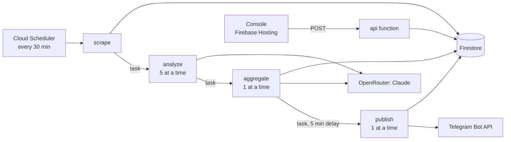

# Telegator

Telegator collects posts from public Telegram channels and asks an AI model to classify each one. It groups the posts that report the same story into one message and publishes that message to target channels. When more sources report the story, the message is **edited in place**. Operators use a web console to watch the pipeline and step in.

## 1. The system in one picture



**The queue is the pipeline.** A post in flight is a Cloud Tasks payload and is never stored. It becomes durable only when `aggregate` absorbs it into a message, and it is stored *inside* that message. A post that is dropped or dies leaves only a counter, a log line, or a dead letter.

| Concern | Firebase piece | Code |
| --- | --- | --- |
| Clock | `onSchedule`, every 30 min | `tg-functions/index.ts` |
| Work in flight | Cloud Tasks queues, `onTaskDispatched` | `tg-firebase/tasks.ts` |
| Durable records | Firestore: `sources`, `targets`, `messages` | `tg-firebase/db.ts` |
| Failed work | Firestore `deadLetters` | `tg-firebase/deadLetters.ts` |
| Counters | Firestore `metrics`, one doc per hour | `tg-firebase/metrics.ts` |
| Operators | Firebase Auth + Firestore `users` | `tg-firebase/operators.ts` |
| Console API | one `onRequest` function, `api` | `tg-api/` |
| Console | Arrmatura app on Firebase Hosting | `tg-web/` |
| Secrets | `defineSecret` (Secret Manager) | `tg-functions/index.ts` |

## 2. Data

All ids that contain `/` (`channel/12345`) are stored with `~` in the document id. The real id is always in the `id` field. A delete is **soft**: it sets `deleted: true`, and lists hide that row.

### 2.1 `sources` — channels to poll

| Field | Meaning |
| --- | --- |
| `id` | Channel username; also the scrape URL segment. |
| `status` | `ok` enables polling. Any other value disables it. |
| `target`, `category`, `tags`, `teaser` | Operator settings stamped onto every post. `teaser` is boilerplate stripped from the body. |
| `via` | `web` (public preview page, default) or `mtproto` (a logged-in account). |
| `lastItemId` | Newest post id seen. The `?after=` cursor and **the only duplicate guard** on the way in. |
| `lastCount`, `lastUpdated`, `lastResult` | Last poll: post count, epoch ms, ISO time of success. |
| `zeroYieldRuns`, `lastNonZeroCount` | Empty polls in a row, and the last non-empty count. Together they detect a stale source. |

### 2.2 The post in flight

`scrape` → `analyze`: `id` (`{source}/{tgId}`), `body` (links replaced by `[text](#N)` tokens), `links`, `image`, `forwardedFrom`, `target`, `category`, `tags`, `date` (**the scrape day**, which is the dedup partition) and `kind`. `analyze` → `aggregate` adds the AI fields of §4.

### 2.3 `messages` — stories

| Field | Meaning |
| --- | --- |
| `id` | The first item's id. |
| `status` | `topublish` → `published`. A merge sets it back to `topublish`. |
| `members` | Map `itemId → {summary, links, channel, ts}`: all that publish renders. At most **20**. |
| `memberCount`, `memberIds` | Size of the map, and its keys (for the replay check). |
| `keyEntities`, `keyTitle`, `keyTags` | The dedup match key (§5). |
| `date`, `title`, `category`, `country`, `location`, `peoples`, `tags`, `image` | Copied or merged from members. |
| `tgChannel` | Comma-separated targets; `telegator_news` by default. |
| `posts` | Map `target → {tgId, tgAt}`. A post present makes the next publish an **edit**. |
| `ts`, `deleted` | Last write; soft delete. `deleted` is always written, so queries can filter on it. |

The map makes replay free: writing `members.{itemId}` again writes the same value.

### 2.4 `targets`

`id` (channel), `type`, optional `messageTemplate`, and `lastPostedDate` / `lastPostedMessageId`, which publish writes.

## 3. Stages

Each task stage runs one item per invocation. A thrown error retries the task with backoff. On the last attempt the wrapper writes the payload to `deadLetters` instead, because Cloud Tasks would drop it.

| Function | Trigger | Attempts | Concurrency |
| --- | --- | --- | --- |
| `scrape`, `scrapeMtproto` | every 30 min, if `SCRAPE_ENABLED` | — | — |
| `analyze` | queue `analyze` | 3 | 5 |
| `aggregate` | queue `aggregate` | 3 | **1** |
| `publish` | queue `publish` | 5 | **1** |
| `api` | HTTPS | — | — |

### 3.1 scrape

- **Selection.** Sources with `status = ok` and this transport's `via`. A **hot** source (more than 20 posts last run) is always due. A **warm** one (1–20) is due after 30 min, a **cold** one (0) after 240 min. Most overdue first, at most **10** per run.
- **Fetch.** `GET https://t.me/s/{id}?after={lastItemId}` with browser-like headers. Without them Telegram serves a page that parses to nothing. An empty cursor means no `?after=`.
- **Kinds.** `forward`, `empty`, and `obsolete` (posted more than 3 days ago, or with no date) are dropped with a counter. Only `post` is enqueued.
- **Cursor.** Written only when every enqueue succeeded, so a failure retries the window next run.
- **Stale source.** 3 empty runs on a source that once yielded counts `SourceStale`.

### 3.2 analyze

An empty body or a bare link is dropped before the model call. Otherwise one classification (§4). Routing: no category → throw (retry); `importance = low` → drop; otherwise enqueue to `aggregate`. `country` is uppercased, and AI tags are merged with source tags.

### 3.3 aggregate

Dedup (§5) decides **merge** or **create**. A merge writes `members.{itemId}` and the scalars attribute by attribute, keeps `posts`, and sets `topublish`. A create uses a create-if-absent write. Then it asks for a publish. Requests for one message within one 5-minute window share a task id, so a burst of merges publishes once, after the story settles.

The queue runs **one task at a time**. Two items of the same day therefore can never both miss each other's write. SQS FIFO serialised per day; this serialises everything, which is ample at this volume.

### 3.4 publish

1. Skip the message if it is gone, deleted, or no longer `topublish`.
2. For each target that has no current post: assemble the text and send it, or edit it when `posts[target]` exists.
   - Assembly: a header, up to 12 member blocks, then hashtags. The limit is 4096 characters: hashtags are dropped first, then member blocks.
   - A photo is used only for a first send and only when the text fits in 1012 characters.
3. Record `posts` after **every** send, so a retry never posts twice.
4. Write `published` only when every target succeeded. A rejected send throws.

The bot pauses at least 3 s after each send and retries once on `429`. Telegram answers errors with HTTP 200 and `ok: false`.

## 4. AI

Both calls go to Claude through OpenRouter's Anthropic-compatible Messages API (`https://openrouter.ai/api`, no `/v1`; the SDK adds it). The model is `anthropic/claude-haiku-4.5`, defined once in `tg-configs/ai.ts`.

- **Classify** (`tg-ai/openrouter.ts`): JSON-schema output with `title`, `summary` (Belarusian, at most 220 characters, stated in the field description), `country`, `location`, `category` (enum in `tg-enums/categories.ts`), `importance`, `peoples`, `properNames`, `tags`. The system prompt keeps `[text](#N)` tokens intact.
- **Adjudicate** (`tg-ai/adjudicator.ts`): ambiguous dedup pairs, using English fields only. Verdicts are keyed by pair id, and a set that does not cover every pair is an error.
- `npm run smoke:openrouter` is the only check that calls the real model.

## 5. Deduplication

Code: `tg-dedup/`. Constants: `tg-configs/dedup.ts`.

- **Match key**: three sorted, lowercased sets: entities (`peoples` + `properNames`), title words, and tags. A merge takes the sorted union, capped at 256 per set.
- **Score** = weighted Jaccard of the three sets. `J(∅, ∅) = 0`: no evidence is not agreement.
- **Gate**: same `date` only. Category and country are not gated.
- **Band**: score at or above `MERGE_THRESHOLD` → merge. At or below `DISTINCT_THRESHOLD` → separate. In between → adjudicate. A failed adjudication **splits**, because a false merge is worse than a duplicate post.
- **Replay**: an item already in a candidate's `memberIds` merges there before any scoring. A replay is therefore exactly idempotent.
- ⚠️ **Thresholds are provisional.** Run the calibration sweep (`tg-dedup/calibration/`) and record `calibration/record.json` before trusting dedup quality.
- ⚠️ **Known limit**: the sweep scores item against item, but runtime scores item against a message's union key. A message with many members makes true matches score lower.

## 6. Console

`packages/tg-web`: Arrmatura app with these pages: Dashboard, Pipeline, Sources, Targets, Messages.

- **Sign-in**: the platform's `FirebaseService`, with Google in production and the Auth emulator locally. The browser holds no Firestore access; `firestore.rules` denies everything.
- **API**: `POST {data: {action, input}}` to `api`. The answer is `{data: {ok, result}}`, or an error with 400 / 401 / 403 / 500.
- **Roles**: `viewer` < `editor` < `admin`, kept in `users/{uid}.roles`. A first sign-in creates the user **disabled with no roles**, and an admin enables it in Firestore. `users` is read on every call, so disabling takes effect at once.
- **Actions** (`tg-api/actions.ts` maps each to its least role):

| Role | Actions |
| --- | --- |
| viewer | whoami, overview, list sources/targets/messages, members, queues, inspect dead letters, export CSV |
| editor | upsert and soft-delete records |
| admin | scrape now, reset cursors, republish, publish now, replay or purge dead letters |

- **Dashboard numbers** come from the hourly `metrics` docs (24 h counters, 7-day categories). Queue depth is the `counters/pending` doc: +1 on enqueue, −1 when a task finishes or dies.

## 7. Development

```bash
npm install              # also links the private arrmatura checkouts
npm run dev              # emulators + functions watch + console on :8080
```

`npm run dev` builds the functions bundle, then runs three things in parallel:

- the **emulators**: Auth 9099, Functions 5001, Firestore 8180, Tasks 9499, UI 4000. Data persists in `.emulator/`.
- an esbuild **watch** of `tg-functions`. The Functions emulator reloads on every rebuild.
- the **console** with live reload at `http://localhost:8080`.

| Need | Do |
| --- | --- |
| Secrets for the emulator | `packages/tg-functions/.secret.local` (git-ignored), linked from `~/.keys/telegator-functions-secrets.env`. `TELEGRAM_BOT_TOKEN` there is a placeholder, so local runs never post to live channels. Put a test bot's token there to try publishing. |
| Sign in locally | Press *Sign in*. The Auth emulator signs in `dev@example.com`, and the first emulator sign-in is an enabled admin. |
| Data | `FIRESTORE_EMULATOR_HOST=127.0.0.1:8180 npm run seed -- <dir> --write` loads `sources` and `targets` from DynamoDB scan exports. |
| A scrape | *Scrape now* on Sources or Pipeline. Scheduled functions do not fire in the emulator. |

Scripts (`seed`, `mcp`, `cursors:now`) use the emulator when `FIRESTORE_EMULATOR_HOST` is set. Otherwise they use production through `gcloud auth application-default login`.

**Gates**: all four pass before a commit.

```bash
npx tsc --noEmit
npm test                 # vitest inside `firebase emulators:exec` (Firestore + Auth)
npx biome check .
npm run build            # console bundle + functions bundle
```

Tests never touch the network. Pure logic is unit-tested, and Firestore code runs against the emulator. Cloud Tasks and the model are mocked with `vi.mock`. `npm test` cannot start while `npm run dev` holds the ports; in that case run `FIRESTORE_EMULATOR_HOST=127.0.0.1:8180 GCLOUD_PROJECT=demo-test npx vitest run`.

## 8. Deployment

One Firebase project, `telegator-581db`. Functions run in `us-central1`, next to Firestore (`nam5`).

1. The project must be on the **Blaze** plan: Functions, Cloud Tasks and Scheduler need it.
2. Set the secrets once: `firebase functions:secrets:set OPENROUTER_API_KEY`, the same for `TELEGRAM_BOT_TOKEN`, and `npm run mtproto:login` for `MTPROTO_SESSION`.
3. Enable the Google provider in Firebase Auth. Add its OAuth web client id to `firebaseConfig.googleClientId` in `tg-configs/firebase.ts`, and list the site's origins on that client.
4. `npm run deploy`: builds both bundles, then deploys hosting, functions, Firestore rules and indexes.
5. Sign in once, then set your `users/{uid}` to `{enabled: true, roles: ["admin"]}` in the Firestore console.
6. Start the schedule: set `SCRAPE_ENABLED=true` in `packages/tg-functions/.env` and redeploy the functions.

## 9. Decisions and limits

- **Serial aggregate and publish.** Cloud Tasks has no FIFO groups, so both queues dispatch one task at a time. Fine at hundreds of posts a day; revisit with per-day locking if volume grows a hundredfold.
- **Publish dedup** is a task id per message per 5-minute window. A request in a new window is a new publish, which is harmless because publish skips current posts.
- **Send then record.** If writing `posts` fails right after a successful send, the retry posts again. This is rare and is accepted.
- **Counters live in Firestore**, not a metrics service. There are no alarms; the dashboard shows dead letters and stale sources.
- **AWS history.** The AWS build (DynamoDB, SQS, Lambda, Cognito, CDK) ran until 2026-10-20 and lives in git history before this rewrite.
